# تصميم نموذج البيانات وخطة الترحيل — المرحلة D

**الحالة:** التصميم معتمد للانتقال إلى المرحلة E؛ أُنشئ migration إضافي ولم يُطبّق على قاعدة فعلية.  
**المرجع:** متطلبات [SRS](./SRS.md) المعتمدة للانتقال إلى المرحلة D، والمخطط الحالي في ملفات migrations.  
**حدود المرحلة:** توثيق الكيانات والعلاقات والقيود والفهارس وخطة الانتقال فقط. لا يتصل هذا التصميم بقاعدة فعلية ولا يفترض أن migrations الحالية طُبّقت عليها.

## 1. مبادئ التصميم

1. تبقى PostgreSQL مصدر الحقيقة. تستخدم أعمدة typed ومفاتيح وعلاقات وقيود للبيانات الجوهرية؛ يظل JSONB للسياسات المرنة والحمولات المساندة، لا بديلاً عن المفاتيح أو العلاقات.
2. `company_id` هو حد العزل الافتراضي لسجلات الأعمال. وجود `group_id` لا يمنح وصولاً موروثاً إلى شركات المجموعة؛ يلزم اعتماد سياسة عضوية المجموعة قبل ذلك.
3. لكل علاقة بين سجلات أعمال من الشركة نفسها مفتاح أجنبي مركب يضم `company_id`. هوية المستخدم عالمية وليست سجل أعمال؛ لذلك ترتبط العضوية بـ`erp_users.id` ولا يُشترط أن تتطابق شركة العضوية مع الشركة الأصلية للحساب.
4. تُحفظ العلاقات التنظيمية والتعيينات ذات الأثر التاريخي بفترات سريان. تنتهي العلاقة القديمة ولا تُمحى عند إنشاء علاقة جديدة.
5. تظل العمليات المرحلة والتدقيق قابلين للتتبع. تصحيح المستند المرحلة يكون بمستند عكسي مرتبط، لا بتعديل أو حذف صامت.
6. التغيير تدريجي ومتوافق: إضافة ثم تعبئة/مطابقة ثم تحويل القراءة والكتابة ثم إيقاف القديم بعد التحقق. لا تُحذف بيانات أو أعمدة قديمة في مرحلة الترحيل الأولى.
7. تستخدم المعرفات UUID للكيانات الجديدة، مع الإبقاء على `erp_users.id` و`erp_records.record_id` كنص أثناء التوافق مع النظام الحالي.

## 2. مخطط العلاقات المنطقي

المخطط يوضح الملكية والعلاقات الرئيسية فقط؛ لا يحدد إعدادات مالية أو ضريبية معلقة في SRS.

```mermaid
erDiagram
    ERP_GROUPS o|--o{ ERP_COMPANIES : groups
    ERP_COMPANIES ||--o{ ERP_BRANCHES : owns
    ERP_BRANCHES ||--o{ ERP_LOCATIONS : contains
    ERP_COMPANIES ||--o{ ERP_COMPANY_MEMBERSHIPS : grants
    ERP_USERS ||--o{ ERP_COMPANY_MEMBERSHIPS : joins
    ERP_USERS ||--o{ ERP_SESSIONS : authenticates
    ERP_COMPANIES ||--o{ ERP_SESSIONS : scopes

    ERP_COMPANIES ||--o{ ERP_PEOPLE : employs
    ERP_USERS o|--o{ ERP_PEOPLE : may_link
    ERP_COMPANIES ||--o{ ERP_ORG_UNIT_TYPES : configures
    ERP_ORG_UNIT_TYPES ||--o{ ERP_ORG_UNITS : classifies
    ERP_COMPANIES ||--o{ ERP_ORG_STRUCTURE_TYPES : configures
    ERP_ORG_STRUCTURE_TYPES ||--o{ ERP_ORG_UNIT_RELATIONSHIPS : classifies
    ERP_ORG_UNITS ||--o{ ERP_ORG_UNIT_RELATIONSHIPS : parent
    ERP_ORG_UNITS ||--o{ ERP_ORG_UNIT_RELATIONSHIPS : child
    ERP_COMPANIES ||--o{ ERP_POSITIONS : defines
    ERP_ORG_UNITS ||--o{ ERP_POSITIONS : hosts
    ERP_JOB_FAMILIES ||--o{ ERP_POSITIONS : groups
    ERP_JOB_LEVELS ||--o{ ERP_POSITIONS : grades
    ERP_JOB_TITLES ||--o{ ERP_POSITIONS : names
    ERP_PEOPLE ||--o{ ERP_EMPLOYEE_ASSIGNMENTS : assigned
    ERP_POSITIONS ||--o{ ERP_EMPLOYEE_ASSIGNMENTS : filled_by
    ERP_ORG_STRUCTURE_TYPES ||--o{ ERP_REPORTING_RELATIONSHIPS : classifies
    ERP_EMPLOYEE_ASSIGNMENTS ||--o{ ERP_REPORTING_RELATIONSHIPS : subordinate
    ERP_EMPLOYEE_ASSIGNMENTS ||--o{ ERP_REPORTING_RELATIONSHIPS : manager

    ERP_COMPANY_MEMBERSHIPS ||--o{ ERP_MEMBERSHIP_ROLES : assigned
    ERP_ROLES ||--o{ ERP_MEMBERSHIP_ROLES : grants
    ERP_ROLES ||--o{ ERP_ROLE_PERMISSIONS : contains
    ERP_PERMISSIONS ||--o{ ERP_ROLE_PERMISSIONS : defines
    ERP_COMPANIES ||--o{ ERP_POLICY_RULES : configures
    ERP_COMPANIES ||--o{ ERP_DELEGATIONS : authorizes

    ERP_WORKFLOW_DEFINITIONS ||--o{ ERP_WORKFLOW_STEPS : contains
    ERP_WORKFLOW_DEFINITIONS ||--o{ ERP_WORKFLOW_INSTANCES : starts
    ERP_WORKFLOW_INSTANCES ||--o{ ERP_APPROVALS : records
    ERP_COMPANIES ||--o{ ERP_WORKFLOW_INSTANCES : scopes

    ERP_COMPANIES ||--o{ ERP_COMMANDS : scopes
    ERP_COMMANDS ||--o{ ERP_TASKS : creates
    ERP_PROJECTS o|--o{ ERP_TASKS : tracks
    ERP_COMPANIES ||--o{ ERP_AUDIT_LOG : audits
    ERP_COMPANIES ||--o{ ERP_OUTBOX : dispatches
    ERP_COMPANIES ||--o{ ERP_RECORDS : legacy_bridge
```

## 3. الكيانات والنطاق المقترح

الأسماء أدناه منطقية ومتوافقة قدر الإمكان مع بادئة `erp_` الموجودة. لا تعني أنها DDL جاهزاً للتطبيق.

### 3.1 المجموعة والشركة والمواقع

| الكيان | الحقول والعلاقات الأساسية | الضوابط |
|---|---|---|
| `erp_groups` | `id`, `code`, `name`, `status`, `created_at`, `updated_at` | `code` فريد بعد التطبيع؛ لا تمنح المجموعة صلاحية وصول تلقائية. |
| `erp_companies` (قائم) | `id`, `name`; يضاف لاحقاً `group_id` nullable، الاسم القانوني، الدولة، العملة، المنطقة الزمنية، الحالة | لا تُملأ `group_id` تلقائياً؛ لا يُعتمد ربط الشركات الحالية بمجموعات قبل قرار العميل. |
| `erp_branches` | `company_id`, `id`, `code`, `name`, `status`, تواريخ السريان | `UNIQUE (company_id, id)` و`UNIQUE (company_id, code)`؛ الشركة مالكة الفرع. |
| `erp_locations` | `company_id`, `id`, `branch_id`, `code`, `name`, `location_type`, `status` | مفتاح مركب إلى الفرع؛ يمكن أن يكون الموقع غير تابع لفرع فقط إذا اعتمدت السياسة ذلك. |
| `erp_company_settings` (مقترح لاحق) | `company_id`, `setting_key`, `setting_value`, `updated_at` | خارج migration التأسيسي؛ يُحسم عند اعتماد إعدادات الشركة. تبقى حقول الدولة والعملة والمنطقة الزمنية typed بعد اعتمادها. |

### 3.2 الحساب والعضوية والشخص

| الكيان | الحقول والعلاقات الأساسية | الضوابط |
|---|---|---|
| `erp_users` (قائم) | حساب الدخول ومعرّف نصي، اسم المستخدم المطبع، بيانات الدخول والحالة؛ `company_id` الحالي يعامل مؤقتاً كشركة أصل/توافق | لا تنقل كلمات المرور إلى سجل شخص أو JSONB. لا تغيّر دلالة تسجيل الدخول أو تفرد أسماء المستخدمين قبل اعتماد سياسة الهوية. |
| `erp_company_memberships` (قائم) | `company_id`, `user_id`, الدور/الصلاحيات الحالية، `is_active`, `is_default` | المفتاح `(company_id, user_id)`؛ العضوية النشطة هي شرط الوصول للشركة. تبقى أعمدة `role` و`permissions` للتوافق أثناء التحويل. |
| `erp_sessions` (قائم) | `id`, `company_id`, `user_id`, `token_hash`, `expires_at` | فهرس انتهاء الجلسة؛ يرفض الخادم الجلسة عند غياب العضوية الفعالة. لا يخزن الرمز الخام. |
| `erp_people` | `company_id`, `id`, `user_id` nullable, بيانات تعريف واتصال لازمة للعمل، `status` | الشخص مستقل عن حساب الدخول. يُسمح بعدم وجود حساب، ولا تدمج سجلات أشخاص متشابهة بالاسم وحده. |
| `erp_employee_assignments` | `company_id`, `id`, `person_id`, `position_id`, `org_unit_id`, `branch_id`, `assignment_type`, `status`, `valid_from`, `valid_to`, مصدر العملية | فترات صحيحة وغير متداخلة وفق سياسة المنشأة؛ حفظ النقل والتكليف والإعارة وإنهاء الخدمة كتاريخ. |

إذا رُبط شخص بحساب، يكون الربط اختيارياً وتتحقق الخدمة من أن الربط صحيح وضمن الصلاحية. قواعد «شخص واحد لكل حساب» أو تعدد التعيينات تظل قراراً قابلاً للتهيئة وليست افتراضاً هنا.

### 3.3 التنظيم والوظائف

| الكيان | الحقول والعلاقات الأساسية | الضوابط |
|---|---|---|
| `erp_org_unit_types` | `company_id`, `id`, `code`, `name_ar`, `name_en`, `status` | نوع المستوى قابل للتهيئة ولا يعتمد على قائمة ثابتة في الشيفرة. |
| `erp_org_structure_types` | `company_id`, `id`, `code`, `name_ar`, `name_en`, `allows_multiple_parents`, `status` | تعريف مستقل لنوع العلاقة التنظيمية، مثل الإداري والوظيفي والجغرافي؛ لا يخلط نوع الوحدة بنوع العلاقة. |
| `erp_org_units` | `company_id`, `id`, `unit_type_id`, `code`, `name_ar`, `name_en`, `status` | لا يخزن `parent_id` وحيداً كمصدر حقيقة إذا كانت البنى مصفوفية أو متعددة. |
| `erp_org_unit_relationships` | `company_id`, `id`, `structure_type_id`, `parent_unit_id`, `child_unit_id`, `valid_from`, `valid_to`, مرجع المصدر والمعتمد | `parent_unit_id <> child_unit_id`؛ منع الدورات والتحقق من تداخل الفترات داخل معاملة. تخزين الإداري والوظيفي والجغرافي كأنواع علاقات منفصلة. |
| `erp_job_families`, `erp_job_levels`, `erp_job_titles` | معرّف ونطاق الشركة ورمز/اسم وحالة، وحقول الترتيب عند الحاجة | تعريفات قابلة للتهيئة؛ الاسم أو المستوى لا يمنح صلاحية نظامية. |
| `erp_positions` | `company_id`, `id`, `code`, `org_unit_id`, `job_family_id`, `job_level_id`, `job_title_id`, `status`, حدود المسؤولية | المنصب كتعريف تنظيمي؛ شغله وسجل تاريخه في التعيينات. |
| `erp_reporting_relationships` | `company_id`, `id`, `structure_type_id`, `assignment_id`, `manager_assignment_id`, `valid_from`, `valid_to`, مرجع المصدر | يدعم مديراً إدارياً ووظيفياً مختلفين؛ يمنع العلاقة الذاتية والدورة. |

### 3.4 الصلاحيات والتفويض والتدقيق

| الكيان | الحقول والعلاقات الأساسية | الضوابط |
|---|---|---|
| `erp_roles` | `company_id`, `id`, `code`, `name`, `status`, `is_system` | الأدوار المخصصة للشركة لا تتعارض بالرمز داخلها؛ لا تربطها بمسمى وظيفي. |
| `erp_permissions` | `id`, `code`, `resource`, `action` | قاموس أفعال مستقر؛ لا يخزن نسخة لكل شركة إلا إذا دعت الحاجة المعتمدة. |
| `erp_role_permissions` | `company_id`, `role_id`, `permission_id`, `scope_definition` | تعيين واحد لكل دور وإذن في الشركة؛ نطاق ABAC يُتحقق منه خادمياً. |
| `erp_membership_roles` | `company_id`, `user_id`, `role_id`, `valid_from`, `valid_to` | علاقة العضوية بالدور؛ تسمح بتعدد الأدوار عند اعتماد السياسة. |
| `erp_policy_rules` | `company_id`, `id`, `resource`, `action`, `effect`, شروط محددة، `version`, `status` | شروط JSONB مسموحة فقط للسياسات القابلة للتكوين، مع تحقق schema وإصدار. |
| `erp_delegations` | `company_id`, `grantor_user_id`, `delegate_user_id`, النطاق والفعل والحد المالي/العملة، `valid_from`, `valid_to`, `revoked_at` | لا تفويض ذاتي؛ لا يتجاوز دور المانح، ويسجل الإنشاء والإلغاء والاستخدام. |
| `erp_audit_log` (قائم) | `company_id`, الفاعل، الفعل والوحدة والتفاصيل والوقت؛ توسعة مستقبلية لمعرف السجل والقيم السابقة/الجديدة والنتيجة و`request_id` | سجل إضافي لا يعدل من واجهة الأعمال؛ يمنع تسجيل كلمات المرور والرموز والأسرار. |

### 3.5 سير العمل والعمليات المؤسسية

| الكيان | الحقول والعلاقات الأساسية | الضوابط |
|---|---|---|
| `erp_workflow_definitions` | `company_id`, `id`, `code`, `version`, `status`, `effective_from` | النسخة المعتمدة غير قابلة للتعديل؛ التعديل ينشئ نسخة جديدة. |
| `erp_workflow_steps` | `company_id`, `workflow_id`, `step_key`, `sequence` أو مجموعة توازٍ، شروط، نوع المعتمد، حدود | ترتيب/توازٍ واضحان؛ الشروط تقيمها خدمة موثوقة لا المتصفح. |
| `erp_workflow_instances` | `company_id`, `id`, `workflow_id`, `source_entity`, `source_record_id`, `status`, `idempotency_key` | فريد حسب الشركة ومفتاح إعادة المحاولة؛ مرجع المصدر يبقى نصياً إلى أن تصبح كيانات الوحدات typed. |
| `erp_approvals` | `company_id`, `id`, `instance_id`, `step_key`, `approver_user_id`, القرار، السبب، الوقت | كل قرار مرتبط بهوية ونسخة سير العمل؛ يمنع تضارب المنشئ/المعتمد بحسب السياسة. |
| `erp_commands`, `erp_tasks`, `erp_projects` | معرف مرجعي، المنشأة، المنشئ، المسؤول، الأولوية، الحالة، المواعيد والعلاقات | أوامر ومهام ذات معرفات ثابتة وسجل حالة؛ تُربط بالموافقات عند الحاجة. |
| `erp_documents` | `company_id`, `id`, `object_key`, النوع، الحجم، checksum، المالك/المرجع، التصنيف والاحتفاظ | تحفظ قاعدة البيانات بيانات وصفية فقط؛ التخزين الخاص لا يكون رابطاً عاماً، وسياسة الاحتفاظ TBD. |
| `erp_notifications` | `company_id`, `id`, `recipient_user_id`, نوع المصدر، مرجع المصدر، `read_at`, `created_at` | فهرس صندوق الوارد؛ تجنب نسخ محتوى سري إلى قناة إشعار غير مخولة. |
| `erp_outbox` (قائم) | `company_id`, نوع الحدث، مرجع التجميع، مفتاح idempotency، الحمولة، الحالة والمحاولات | فريد `(company_id, idempotency_key)`؛ الحمولة لا تحتوي أسراراً، ويعاد المحاولة وفق سياسة محدودة. |

تظل محادثات ورسائل الفريق الحالية في `erp_team_messages` أثناء الانتقال. يمكن لاحقاً تقسيمها إلى محادثات ورسائل عند الحاجة لخصائص جديدة، مع حفظ صلاحيات المشاركين والقراءة وعدم تحويل الرسائل إلى سجل عام قابل للتصفح.

### 3.6 مجالات الأعمال والمرحلة اللاحقة

`erp_records` (قائم) يبقى جسر توافق للكيانات التي لم تنتقل. لكل مجال منظم لاحقاً مجموعة جداول typed مرتبطة بالشركة، ولا تُنشأ قيود مالية أو سياسة تكلفة أو ضريبة في هذه المرحلة.

| المجال | عائلات كيانات مستهدفة | علاقات حاكمة |
|---|---|---|
| الأطراف وCRM | العملاء والموردون وجهات الاتصال والعناوين والتفاعلات | كل علاقة ومعاملة تشير إلى معرف الطرف، لا الاسم الحر. |
| المبيعات والمشتريات | عروض/طلبات/أوامر/فواتير/مرتجعات وبنودها والتحصيلات/المدفوعات | رأس وبنود بعلاقة مركبة مع الشركة؛ المستند المصدر محفوظ لأغراض التدقيق. |
| المخزون | الأصناف، وحدات القياس، المستودعات والمواقع، الحركات، الحجوزات، الدفعات/الأرقام التسلسلية | الحركات دفتر append-only؛ الرصيد المادي مشتق أو محدث ضمن معاملة مجال. |
| المحاسبة | دليل الحسابات، الفترات، القيود وبنودها، الذمم، التسويات | كل قيد متوازن ويرتبط بمصدر وفترة وشركة؛ تفاصيل السياسات المالية TBD. |
| المجال الميداني | المناطق، تكليفات المندوب، الزيارات، موافقات الموقع ونتائج المطابقة | إحداثيات موقع الزيارة تحفظ فقط بعد موافقة ضمن المهمة، وفق سياسة الاحتفاظ المعتمدة. |

لا يُنشأ جدول موحد لجميع المجالات يحاكي `erp_records`؛ التوسع يكون على دفعات بعد تثبيت مخطط كل مجال واختبار معاملاته.

## 4. القيود والفهارس

### قيود عامة

- المفتاح الأساسي لكل جدول أعمال: `id`; ويضاف `UNIQUE (company_id, id)` عند الحاجة لمراجع مركبة.
- كل مرجع بين كيانين مملوكين للشركة يستخدم `FOREIGN KEY (company_id, referenced_id)` إلى مفتاح مركب مماثل، مع سياسة `ON DELETE RESTRICT` للبيانات المالية/التاريخية.
- قيود `CHECK` للقيم الرقمية غير السالبة، الفترات الصحيحة، القيم المدعومة والحالات؛ تجنب enums PostgreSQL التي يصعب تعديلها في إعدادات العملاء.
- حذف المستخدم/الشركة لا يمحو المستندات التاريخية؛ تعطيل/أرشفة أو إبطال عضوية بحسب السياسة.
- لا تُنشأ uniqueness على أكواد حالية قبل تقرير كشف التكرارات وسياسة الأرشفة.

### فهارس مرشحة

1. العضويات والجلسات: `(user_id, company_id) WHERE is_active`؛ و`(expires_at)` للجلسات؛ ومرشح فريد واحد للعضوية الافتراضية لكل مستخدم إذا استمرت السياسة.
2. فهرسة قوائم السجلات: `(company_id, status, created_at DESC, id DESC)` أو `(company_id, updated_at DESC)` حسب نمط الشاشة.
3. التنظيم: `(company_id, structure_type_id, parent_unit_id, valid_from DESC)` ونسخة مماثلة على `child_unit_id`; والتعيينات `(company_id, person_id, valid_from DESC, valid_to)`.
4. سير العمل: `(company_id, status, created_at DESC)`؛ وصندوق اعتماد `(company_id, approver_user_id, status, due_at)`.
5. التدقيق: `(company_id, created_at DESC, id DESC)`؛ والتصفية الإضافية على `(company_id, actor_user_id, created_at DESC)` عند ثبوت استخدامها.
6. Outbox: `(state, available_at)` الجزئي للصفوف القابلة للعمل، مع uniqueness على مفتاح idempotency داخل الشركة.
7. الرسائل: `(company_id, sender_id, recipient_id, created_at DESC, id DESC)` مع فهرس unread جزئي للمستلم؛ يراجع الفهرس الحالي مقابل استعلامات المحادثات قبل تغييره.
8. الجداول ذات بحث نصي/JSONB: لا يضاف GIN إلا لمرشح واستعلام مثبت؛ الفهرس العام الحالي على `erp_records.data` يعاد تقييم كلفته قبل استبداله.

تُقاس أحجام الجداول وخطط الاستعلام أولاً؛ الفهارس على جداول كبيرة تُنشأ بخطة تشغيل تراعي دعم `CREATE INDEX CONCURRENTLY` وعدم تشغيله ضمن معاملة migration عند الحاجة.

## 5. خطة الترحيل المرحلية

**شرط مسبق:** حالة تطبيق migrations الموجودة غير معروفة. قبل إعداد أو تنفيذ أي SQL، يجب مقارنة ملفات المشروع بسجل migrations في بيئة اختبار معزولة، وأخذ نسخة احتياطية مجربة. لا تستخدم `erp_restore_snapshot` للترحيل؛ الدالة الحالية تحذف سجلات الشركة من `erp_records` قبل الاستعادة.

| المرحلة | الإجراء | بوابة التحقق/الرجوع |
|---|---|---|
| D0 — اكتشاف آمن | جرد schema الفعلي وسجل migration وأعداد الصفوف حسب الشركة/الكيان، دون تعديل بيانات أو كشف أسرار | إيقاف العمل عند اختلاف غير مفهوم بين schema الحي والملفات؛ حفظ تقرير baseline ونسخة اختبار قابلة للاستعادة. |
| D1 — تأسيس إضافي | إضافة جداول المجموعة/الفرع/الهيكل/الشخص/التعيين والصلاحيات المنظمة بمعرفات جديدة؛ إضافة أعمدة nullable فقط عند الحاجة | لا حذف أو إعادة تسمية أو فرض قيود غير متحققة. يمكن تعطيل التطبيق الجديد مع بقاء المخطط الإضافي. |
| D2 — ربط العضويات والهوية | تدقيق `erp_users` و`erp_company_memberships` و`erp_sessions`، ثم تعبئة جداول الربط المنظمة من المصدر الموثوق | مطابقة أعداد الحسابات والعضويات النشطة/المعطلة؛ عدم تصدير أو طباعة password hashes أو session tokens. |
| D3 — التنظيم والتعيينات | تجهيز خرائط للموظفين والوحدات والمناصب من بيانات المصدر الحالية؛ إنشاء تقرير تعارضات للأسماء والقيم غير المكتملة | لا تُدمج أقسام أو أشخاصاً بالتشابه النصي؛ كل دمج يدوي يحتاج اعتماداً وسجل mapping. |
| D4 — نقل المجالات | نقل مجال واحد في كل مرة من `erp_records` إلى جداول typed؛ البدء ببيانات مرجعية ثم مستندات غير مرحلة، ثم اختيار مستندات مرحّلة بعد تحقق مستقل | مطابقة أعداد ومعرفات ومجاميع ومراجع؛ تشغيل اختبارات عزل الشركة والمعاملات؛ الاحتفاظ بالمصدر للقراءة أثناء نافذة التوافق. |
| D5 — تبديل القراءة والكتابة | تفعيل مصدر الحقيقة الجديد لكل مجال عبر flag مضبوط خادمياً؛ تجنب dual-write غير ذري؛ استخدام سجل mapping/Outbox أو معاملة واحدة للانتقال | اختبار canary في قاعدة اختبار؛ مراقبة الأخطاء والعدّ والمصالحة؛ الرجوع إلى القراءة القديمة قبل إيقافها عند فشل المطابقة. |
| D6 — الإيقاف المؤجل | جعل الكيان القديم للقراءة فقط، ثم حذف مساره فقط بعد اعتماد مدة الاحتفاظ والاستعادة | حذف جداول/أعمدة قديمة ليس جزءاً من هذه المرحلة ولا يحدث في نفس migration مع cutover. |

### المطابقة المطلوبة لكل دفعة

- عدد الصفوف حسب `company_id` و`entity` والحالة، مع تفسير كل صف مرفوض أو مكرر.
- فحص المراجع اليتيمة ومراجع الشركات المتقاطعة قبل وبعد النقل.
- مقارنة hash لمحتوى المصدر بعد تطبيع معلن، إضافة إلى حقول مهمة ومجاميع مالية/كمية عند وجودها.
- تقرير mapping ثابت من `(company_id, entity, record_id)` إلى `(company_id, target_entity, target_id)` مع uniqueness على المصدر والهدف المناسبين.
- عدم ترحيل بيانات تجريبية ثابتة من الشيفرة باعتبارها سجلات منشأة.

## 6. خطة التراجع والاستعادة

1. **قبل القطع:** تعطيل feature flag والرجوع للقراءة القديمة؛ تبقى الجداول الجديدة والبيانات المعبأة دون حذف.
2. **بعد كتابة متزامنة:** لا يُفترض أن عكس الكتابة إلى JSON يعيد الحالة؛ تعتمد المصالحة على مصدر الحقيقة وسجل mapping وOutbox قبل إعادة التوجيه.
3. **بعد القطع:** تراجع نسخة التطبيق إلى الإصدار السابق مع إبقاء المخطط الإضافي. لا تشغّل migration عكسية تحذف بيانات جديدة.
4. **استعادة قاعدة:** استعد نسخة احتياطية إلى بيئة معزولة أولاً، وتحقق من الشركة والأعداد والقيود قبل تحويل المرور؛ لا تستعد snapshot فوق بيانات تشغيلية مباشرة.
5. migrations التحويلية تكون forward-compatible وقابلة لإعادة التشغيل بأمان حيث أمكن، مع checkpoint لكل دفعة ومدة توقف معتمدة إذا لم يمكن الترحيل دونها.

## 7. اختبارات قبول التصميم قبل كتابة migration

- كل علاقة بين سجلين للشركة تستخدم مفاتيح تمنع مرجعاً من شركة أخرى، مع استثناء الهوية العامة والعضوية المصرح بها.
- استعلام العضوية والجلسة يثبت أن العضوية المعطلة تمنع الطلبات الجديدة وأن تعطيل الحساب يبطل الجلسة.
- اختبارات تواريخ سابقة للتعيين والعلاقات التنظيمية، ومنع الدورة أو الفترة غير الصالحة.
- اختبارات uniqueness بعد تقرير مسبق عن المكررات، لا على عينة تخمينية.
- اختبارات عدم توازن قيد، أو تجاوز مخزون، أو إعادة ترحيل مستند عند إضافة مخططات المجالات في مراحلها.
- اختبار backup/restore كامل في بيئة معزولة، ثم تجربة rollback لنسخة التطبيق دون حذف المخطط أو البيانات الجديدة.
- مراجعة خطط الاستعلام والفهارس مع حجم بيانات ممثل، واختبار عزل سلبي عبر API وقاعدة البيانات.

## 8. قرارات تمنع تثبيت بعض القيود

لا يجمّد هذا التصميم القرارات التي أبقاها SRS مفتوحة: نطاق المستأجر وميراث وصول المجموعة، سياسة المصادقة وتفرد اسم المستخدم، أنواع الهياكل والتعيينات المعتمدة، الدولة والعملة والضريبة، القيود المزدوجة والحسابات والتكلفة، حفظ الموقع والوثائق والتدقيق، وسياسة حذف/احتفاظ البيانات. تحفظ هذه القيم كإعدادات أو يكتمل تصميم المجال بعد اعتمادها؛ لا يملأها التنفيذ بافتراضات.

## 9. حالة المرحلة

- تم اعتماد SRS وتصميم المرحلة D للانتقال إلى E.
- أُنشئ `supabase/migrations/20261118000000_enterprise_core.sql` كتوسعة إضافية وفق التصميم؛ لم يُشغّل أو يُطبّق على قاعدة فعلية.
- رُبطت واجهة الهيكل التنظيمي بـAPI للشركة، وأضيفت عمليات RPC ذرية لإنشاء العلاقات وإنهائها مع فحوص الدورات والتدقيق.
- أُعد اختبار SQL تكاملي يعيد بيانات الاختبار بـ`ROLLBACK`، لكنه لم يُشغّل لعدم توفر PostgreSQL محلياً؛ لم تُنقل بيانات.
- يلزم تشغيل الترحيل والاختبار على قاعدة معزولة، ثم مراجعة النتائج قبل أي تطبيق على قاعدة حية أو بدء المرحلة التالية.
